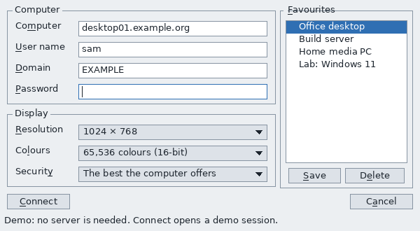
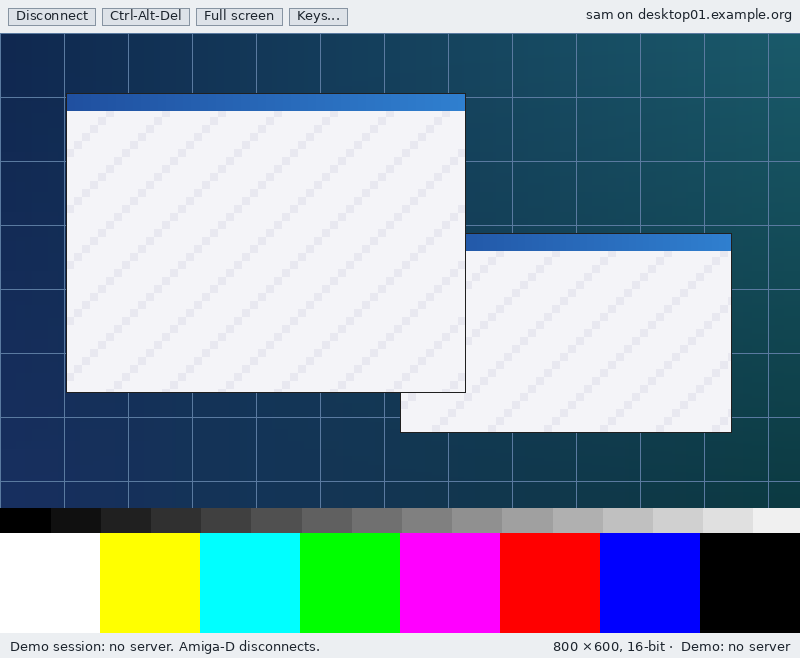

# GFAmigaRDP

A Remote Desktop (RDP) client for AmigaOS 3.2 on the 68040, written from
scratch by **Team 6 (Sacredtrees)**. It is based on **The Open SDK by the
AmiCradle Team**: GFOpenLayout's UI themed by GFOpenGadTools, GFOpenTLS for
TLS, GFOpenCrypto for the hashes and ciphers, and OpenNDK's headers.

MIT licensed (LICENSE), Copyright (c) 2026 AmiCradle Team.

## Clean room

GFAmigaRDP is implemented only from Microsoft's published Open
Specifications and the Amiga autodocs. It contains no code, structure or
comments from FreeRDP, WinPR, rdesktop or any other RDP implementation.
CLEAN-ROOM.md has the rules and the list of allowed sources.

Specifications used:

| Spec | For |
|------|-----|
| [MS-RDPBCGR] | the core protocol: X.224, MCS/GCC, security, capabilities, input, bitmap updates |
| [MS-RDPELE] | licensing |
| [MS-CSSP] | CredSSP (NLA) |
| [MS-NLMP] | NTLMv2 inside CredSSP |
| [MS-RDPEGDI] | drawing orders, caches, interleaved RLE and planar bitmaps |
| [MS-RDPNSC] | NSCodec (later) |
| [MS-RDPECLIP], [MS-RDPEA] | clipboard and sound channels (later) |
| ITU-T T.123, X.224, T.125, X.690; RFC 1320, 2104, 5280, 5929, 6125 | the layers under RDP |

## State (0.1)

- The connection window and the session window, complete as UI.
- TCP through bsdsocket.library, the X.224 Connection Request/Confirm with
  protocol negotiation, and the TLS upgrade through gfopentls.library.
- A demo mode that needs no server, for screenshots and UI work.
- Not yet: MCS/GCC, NLA, licensing, capabilities, input, bitmaps. See
  docs/DESIGN.md for the plan.

## Layout

| Dir | What |
|-----|------|
| src/core | the protocol: stream reader/writer, X.224, transport, connection sequence |
| src/crypto | X.509 reader; later MD4, RC4, HMAC-MD5, NTLMv2 |
| src/codec | bitmap decoders (later) |
| src/amiga | "amipr": the Amiga layer (timer.device, signals, dos, bsdsocket, GFOpenTLS/GFOpenCrypto) |
| src/ui | the windows: connection, session, desktop drawing, favourites |
| tests | X224Test; RDPProbe |
| tools/preview | a PC-side layout preview of the windows |
| docs | DESIGN.md, LAB.txt, preview images |

How POSIX ideas map onto the Amiga here:

| Need | Amiga |
|------|-------|
| sockets | bsdsocket.library v4, one base per task |
| select/poll | WaitSelect with the task's signals |
| sleep, clocks | timer.device UNIT_MICROHZ, GetSysTime |
| threads, TLS slots | tasks/processes, a per-task list keyed by FindTask |
| files, config | dos.library, ENV:/ENVARC: |
| TLS | gfopentls.library |
| hashes, HMAC, AES | gfopencrypto.library |
| drawing | WritePixelArray (CyberGraphX/P96), WriteChunkyPixels, later the gfopengpu stream |
| sound | AHI (later) |

## Build

```
OPENNDK=.../gfopensdk/OpenNDK GFOPENTLS=.../gfopentls OLUI=.../gfopenlayout \
OGT_ROOT=.../amicradle-guest/libraries/opengadtools ./build-amiga.sh
```

STOVE= picks the os32 GCC 16 stove (default ~/AmiCradle/stoves/os32-gcc16),
OUT= the output drawer (default build-amiga), CPU=060 a 68060 build.
libolui.a is built from OLUI when it is missing.

Output: `GFAmigaRDP`, `tools/RDPProbe`, `tests/X224Test`, `Themes/*.theme`,
`Env/GFOpenGadTools/Look`, `README-lab.txt`, `lib/libolui.a`, `SHA256SUMS`.

The X.224 test also runs on a PC: `cc -Isrc/core tests/x224_test.c src/core/x224.c && ./a.out`.

## Run

```
GFAmigaRDP DEMO              ; the connection window, sample favourites
GFAmigaRDP DEMO SESSION      ; the session window with a test pattern
GFAmigaRDP [HOST] [USER=] [DOMAIN=]
```

docs/LAB.txt lists what a machine needs. In short: AmigaOS 3.2, a 68040,
gadtools/diskfont/keymap, a GFOpenGadTools theme in
SYS:Prefs/Presets/Themes/. gfopenlayout.library is not needed (the UI is
linked in). CyberGraphX/P96 is optional (true colour). bsdsocket,
gfopentls and gfopencrypto are needed only for a real connection.

## Preview

`tools/preview/preview.sh` lays the same markup out on a PC with the same
theme and draws it with GFOpenLayout's tests/ui_render.py (needs Pillow).
These show the layout and the theme, not the Amiga's own rendering:



